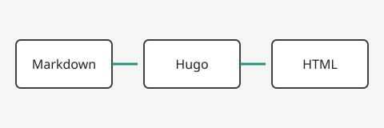

This styleguide collects the body elements of the pochi theme on one page. It is excluded from lists, search and related posts.

## Text and headings {#sg-text}

Pochi is a blog theme for Hugo. It puts reading comfort first and aims to typeset the elements technical articles rely on — headings, lists, code and tables — without breaking when Japanese and Latin text are mixed. For example, Core Web Vitals treats an LCP (Largest Contentful Paint) under 2.5 seconds and a CLS (Cumulative Layout Shift) under 0.1 as "good".

This paragraph mixes **strong emphasis**, *emphasis*, inline code such as `hugo server --buildDrafts` and a [link to the Hugo documentation](https://gohugo.io/documentation/). 日本語の文が欧文の段落に混ざったときの行間と、和欧間のアキもここで確認します。

A long identifier such as `ThisIsAnExtremelyLongIdentifierNameThatShouldWrapInsideTheContainer` must not break the layout, and neither should a long URL: <https://example.com/a/very/long/path/that/keeps/going/to/check/how/the/theme/handles/overflow-wrap/in/narrow/viewports?query=parameter&another=value>

### Heading level 3

A paragraph directly after a heading. The gap between the heading and this paragraph should look smaller than the gap above the heading.

#### Heading level 4

A paragraph after a level 4 heading.

##### Heading level 5

A paragraph after a level 5 heading.

###### Heading level 6

A paragraph after a level 6 heading.

### Lists

- The first bullet. When this item gets long enough to wrap, the second line should align with the text of the first line rather than with the bullet.
- Second item
  - Nested, level 2
    - Nested, level 3
- Third item

1. First numbered item
2. Second item
   1. Nested numbered item
      1. Level 3
3. Third item

- [x] Completed task
- [ ] Open task

## Table {#sg-table}

| Item | Kind | Default | Min | Max | Unit | Property | Support | Note | Status |
| --- | --- | ---: | ---: | ---: | --- | --- | --- | --- | --- |
| Body font size | Type | 16 | 14 | 18 | px | `font-size` | All browsers | Root should stay at 100% | Planned |
| Line height | Type | 1.8 | 1.6 | 2.0 | × | `line-height` | All browsers | Use a unitless value | Planned |
| Measure | Layout | 40 | 35 | 45 | em | `max-inline-size` | All browsers | 35–40 characters for Japanese | Not started |
| Target size | a11y | 44 | 24 | — | px | `min-block-size` | All browsers | WCAG 2.5.8 minimum is 24px | Not started |
| Contrast ratio | a11y | 4.5 | 4.5 | — | :1 | Tokens | — | 3:1 for large text | Partly failing |

## Code {#sg-code}

```go
// latestPosts sorts pages by publish date (newest first), drops drafts and future-dated pages, and returns at most limit pages.
func latestPosts(pages []Page, now time.Time, limit int) []Page {
 published := make([]Page, 0, len(pages))
 for _, p := range pages {
  if p.Draft || p.PublishDate.After(now) { // skip drafts and scheduled posts
   continue
  }
  published = append(published, p)
 }
 sort.Slice(published, func(i, j int) bool { return published[i].PublishDate.After(published[j].PublishDate) })
 if len(published) > limit {
  return published[:limit]
 }
 return published
}
```

```
$ hugo --gc --minify
Total in 312 ms
```

```sh
npm run vrt:update   # update the baselines
```

A long inline code span: `HUGO_PARAMS_LIKEAPI_BASEURL= hugo --gc -s example_site --themesDir /absolute/path/to/themes -t pochi`

## Quotes and supplementary content {#sg-blocks}

> A blockquote. When several sentences follow each other, check the line spacing and the distance to the left rule.
>
> > A nested blockquote.

<blockquote cite="https://www.w3.org/TR/jlreq/">
<p>A blockquote with a cite attribute, used when the source URL is given as an attribute.</p>
</blockquote>

Keyboard notation: press <kbd>Ctrl</kbd> + <kbd>K</kbd> to open search and <kbd>Esc</kbd> to close it.

<details>
<summary>Collapsible content (details and summary)</summary>

A paragraph inside the collapsed block, with `code` and a link ([example.com](https://example.com/)).

</details>

---

Spacing around a horizontal rule.

## Design tokens {#sg-tokens}



## Images and footnotes {#sg-media}




A footnote reference[^1] and a second one[^2].

[^1]: The first footnote, with a link to [Hugo](https://gohugo.io/).
[^2]: The second footnote. It is long enough to wrap so the line spacing and the position of the back link can be checked.
